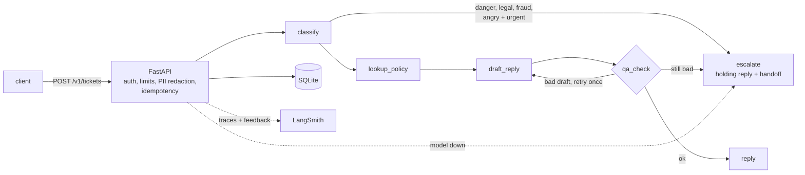

# cx-copilot

A customer-support triage and reply agent built with **LangGraph**, traced with **LangSmith**, served
as an HTTP API, with an eval suite that scores reply quality and a **regression gate** that blocks
any prompt or model change that makes support worse.

**Costs nothing to run.** The model is a free local one (Ollama), tracing uses LangSmith's free
Developer plan, storage is SQLite, and the whole stack runs in Docker on your own machine. CI and
tests use an offline stand-in model, so they need no keys at all.



## Quickstart (offline, no keys)

```bash
pip install -e ".[dev]"
pytest -q                 # 114 tests
cx-gate                   # PASS against evals/baseline.json
cx-serve                  # API on http://localhost:8000, docs at /docs
curl -s localhost:8000/v1/tickets -H 'content-type: application/json' \
     -d '{"text": "I was charged twice for order #4471"}'
```

## Run it for real, free

1. Install [Ollama](https://ollama.com) and pull a model: `ollama pull qwen2.5:7b` (needs about
   16 GB RAM; `llama3.2` works on 8 GB but over-escalates, see the results above)
2. Optional: create a free LangSmith account and an API key, for traces and feedback.
3. Configure and start:
   ```bash
   cp .env.example .env    # set CX_ENV=prod, CX_API_KEYS, CX_MODEL=ollama:qwen2.5:7b
   docker compose up -d    # API + Ollama
   docker compose exec ollama ollama pull qwen2.5:7b
   ```
4. Check it: `curl localhost:8000/readyz`, then send a ticket with your `X-API-Key`.

Before trusting a local model with customers, run `cx-compare` on it (see below) and read the misses.
Operations, backups and limits: [`docs/OPERATIONS.md`](docs/OPERATIONS.md).

## The API

| Endpoint | What it does |
|---|---|
| `POST /v1/tickets` | Handle a ticket. Body `{"text": ..., "ticket_id": optional}`. Resending the same `ticket_id` returns the stored result without calling the model again; reusing it with different text is a `409`. |
| `GET /v1/tickets/{id}` | Fetch a stored result. |
| `POST /v1/tickets/{id}/feedback` | `{"score": 0..1, "comment": ...}`. Stored locally and attached to the exact LangSmith trace. |
| `GET /v1/escalations` | The human queue: everything the agent handed off. |
| `GET /v1/stats` | Tickets, escalations, degraded runs, feedback average. |
| `GET /healthz`, `/readyz` | Liveness and readiness probes (no auth). |

What the service guarantees, each covered by tests:

- **PII never leaves the front door.** Card numbers (Luhn-checked, so order numbers survive), emails,
  phone numbers, SSNs and API keys are replaced with placeholders before the model, the trace, the
  database or the logs see the ticket.
- **No ticket is dropped.** If the model is down, times out or returns garbage, the customer gets the
  holding reply and the ticket lands in `/v1/escalations` with `status: "degraded"`.
- **A LangSmith outage never fails a request.** Tracing is best-effort.
- **Feedback does not cost money.** It is sent with `extend_trace_retention=False`, so attaching a
  score does not upgrade the trace to paid extended retention.
- **Safe retries.** Idempotent on `ticket_id`, including concurrent duplicates.
- **Protected under load.** A bounded number of model calls run at once (`CX_MAX_CONCURRENCY`, to
  protect a local model); beyond that, requests wait up to `CX_QUEUE_TIMEOUT_S` and then get a `503`
  with `Retry-After`. Per-key rate limiting returns `429`.
- **Locked down in prod.** `CX_ENV=prod` refuses to start without API keys of at least 16 characters
  or with the fake model, and turns off `/docs`. Keys are compared in constant time.
- **Observable.** JSON logs with a request id (echoed as `X-Request-ID`), never ticket text.

## Real results: free local models

31 labelled tickets, 3 repeats each, run with Ollama on a MacBook Air. Total cost: $0.

| Setup | Quality | Category | Missed escalations | Unnecessary escalations | Gate (vs qwen + v1) |
|---|---|---|---|---|---|
| qwen2.5:7b, `triage_v1`, model decides | 0.912 | 0.850 | **2 of 18** (`t21`, in 2 of 3 runs) | 1 of 75 | reference |
| **qwen2.5:7b, `triage_v2`, rules decide** | **0.960** | **0.957** | **0 of 18** | **0 of 75** | PASS |
| llama3.2 (3B), `triage_v1`, model decides | 0.847 | 0.753 | 0 of 18 | about 27 of 75 | BLOCKED |
| llama3.2 (3B), `triage_v2`, rules decide | 0.925 | 0.957 | 0 of 18 | about 10 of 75 | BLOCKED |

"18" is 6 tickets that need a human x 3 runs; "75" is the other 25 x 3. Counts for llama are
derived from `escalation_correct` (0.710 and 0.892 of 93).

What it showed:

- **The model with the better overall score still missed a customer who needed a human.** qwen2.5:7b
  beat llama3.2 on quality (0.91 vs 0.85) and category accuracy, but it
  labelled "Worst service ever... I need it TODAY. This is ridiculous." as *frustrated*, so it was
  auto-answered in 2 of 3 runs.
- **Two changes fixed it:** a triage prompt with a definition and examples for every label
  (`triage_v2`), and moving the escalation decision out of the model and into code (`rules`: the
  model only labels; safety/legal or angry + urgent goes to a human).
- **The small model over-reads anger.** llama3.2 called plain tickets like "I was charged twice for
  order #4471" angry and urgent. v2 cut its unnecessary escalations by about two thirds, but its
  replies got worse (policy quoting 0.91 to 0.85), so the gate still blocks it.
- Some llama "escalations" were the QA fallback working: two drafts in a row failed the reply checks,
  so the ticket went to a human instead of sending a bad reply. `cx-compare` now labels these.

Caveats: 31 tickets with my own labels (`t29`, "Refund please... card was charged", is arguably
billing rather than returns); one machine; replies scored by heuristics. Reproduce with:

```bash
cx-compare --models ollama:qwen2.5:7b@triage_v1/model ollama:qwen2.5:7b \
                    ollama:llama3.2@triage_v1/model ollama:llama3.2 --repeats 3 --cache .cx_cache
```

`triage_v2` + `rules` is now the default; `@triage_v1/model` reproduces the original setup.

## What the gate catches (offline demo)

Baseline scores on 31 labelled tickets, then two candidate changes (real output from this repo):

| Change | quality | Metric that tripped | Verdict |
|---|---|---|---|
| "Friendlier" prompt (`reply_v3_friendly`) | 0.988 -> 0.838 | policy_grounded 1.00 -> 0.06, first_try_clean 1.00 -> 0.00 | **BLOCKED** |
| Cheaper model (`fake:lite`) | 0.988 -> 0.969 (inside tolerance) | escalation_recall 1.00 -> 0.50 | **BLOCKED** |
| Tighter prompt (`reply_v2_tighter`) | unchanged | none | PASS |

The second row is the point: the overall score barely moved, but the model stopped escalating angry,
urgent customers. Each metric has its own allowed drop (`MAX_DROP` in `gate.py`); safety and
escalation recall allow none.

Exit codes: `0` pass, `1` regression, `2` setup error. In GitHub Actions the table is written to the
job summary. To accept a change: `cx-gate --prompt <name> --update-baseline` (refused if it fails).

## Compare models and gate changes

```bash
cx-compare --models ollama:llama3.2 ollama:<another-model> --repeats 3 --cache .cx_cache
cx-gate --model ollama:llama3.2 --baseline evals/baseline.llama.json --update-baseline
cx-gate --model ollama:llama3.2 --baseline evals/baseline.llama.json --cache .cx_cache
```

`cx-compare` runs the same 31 tickets through each entry, treats the first as the reference, says
whether the gate would block swapping to each of the others, and lists exactly which tickets each one
got wrong: missed escalations first, then over-escalations and wrong categories, with how many repeats
each happened in. It writes `evals/compare.md` and `.json`.

An entry is `MODEL[@TRIAGE_PROMPT[/ESCALATION]]`, so prompt and policy changes compare the same way:

```bash
cx-compare --models ollama:llama3.2 ollama:llama3.2@triage_v2/rules --repeats 3 --cache .cx_cache
```

- `triage_v2` gives the model definitions and examples for every label (small models over-read anger
  and urgency without them).
- `/rules` makes escalation a code decision: safety/legal, or angry and high urgency. The model only
  supplies the labels.

- `--cache DIR` stores every response, so reruns cost nothing and give identical numbers.
- `--repeats 3` shows run-to-run spread; ignore differences smaller than it.
- A ticket whose model call fails counts as a failure, and `cx-gate` exits `2` instead of reporting a
  fake regression.
- Paid providers also work (`anthropic:<model>`, `openai:<model>`) but are never required.
  `openai_compat:<model>` covers any other OpenAI-compatible server, such as LM Studio or vLLM.

Step-by-step for a first real run: [`docs/REAL_RUN.md`](docs/REAL_RUN.md).

## Layout

```
src/cx_copilot/
  api.py        FastAPI app, auth, rate limits, JSON logging, cx-serve
  service.py    ticket handling: PII, idempotency, fail-safe, tracing, feedback
  config.py     settings from env, validated at startup
  pii.py        redaction      store.py   SQLite storage
  graph.py      LangGraph state machine (nodes, routing, fail-safes)
  models.py     FakeModel, Ollama / OpenAI-compatible, Anthropic, response cache
  kb.py         policy knowledge base + retrieval (swap in your own with CX_KB_PATH)
  rules.py      forbidden phrases, length, PII checks (shared by QA node and scorers)
  scorers.py    evaluators: (outputs, reference_outputs) -> {key, score}
  runner.py     run + aggregate; optional LangSmith experiment
  gate.py       cx-gate CLI (pass/fail against a baseline)
  compare.py    cx-compare CLI (several models, one table)
  prompts/      versioned prompts as markdown (a prompt change is a diff)
  data/         tickets.jsonl (31 labelled tickets)
evals/baseline.json   committed scores the gate compares against
docs/            OPERATIONS.md, REAL_RUN.md, SERIES.md
Dockerfile, docker-compose.yml, examples/kb.northwind.json
```

## How the stand-in model works

`FakeModel` is deterministic. It reads simple directives from the prompt text (for example "quote the
exact policy", "never promise", "at most N words") and builds replies from them, and it classifies
tickets with keyword rules. Change the prompt and its behaviour changes predictably, which is what
you need to test the graph, scorers and gate. **It says nothing about real model quality.**

## Limits

What "production-ready" covers here, and what it does not:

- **Real-model quality is measured on 31 tickets only** (see "Real results"). That is enough to
  catch the failures above, not enough to promise a rate. Grow the dataset with real tickets.
- **Single instance.** The rate limiter is in-process and storage is SQLite, which is right for one
  machine. Scaling out needs a shared limiter and Postgres.
- **No TLS.** The compose file binds to localhost. Put a reverse proxy with HTTPS in front to expose it.
- **The knowledge base is fictional.** Replace it with your policies via `CX_KB_PATH`.
- **Retrieval is keyword-based.** Fine for a small policy set; a large one needs embeddings.
- **Scorers are heuristics** (keyword lists, substring facts), and the dataset is 31 tickets, so one
  ticket moves a metric by about 3 points.
- **Not verified here:** the Docker image could not be built in my environment (Docker Hub was
  blocked), so CI builds and boots it on every push. I ran the same wheel with `cx-serve` in prod mode
  instead. The Ollama, Anthropic and OpenAI adapters are tested against stub clients, not live servers.
- Developed against langgraph 1.2.17, langsmith 0.14.12, fastapi 0.162.

## License

MIT
