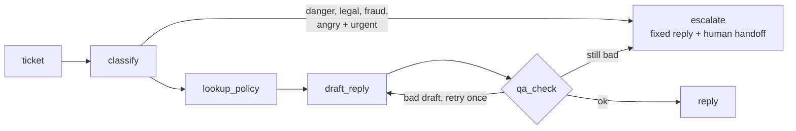

# cx-copilot

A customer-support triage and reply agent built with **LangGraph**, traced with **LangSmith**, with an
eval suite that scores reply quality and a **regression gate** that blocks any prompt or model change
that makes support worse.

Runs fully offline with a stand-in model (no keys, under a second). Plug in your own keys for real results.



## Quickstart (offline)

```bash
pip install -e ".[dev]"
pytest -q                 # 37 tests
cx-gate                   # PASS against evals/baseline.json
cx-copilot "I was charged twice for order #4471. Please fix this."
make demo                 # watch the gate block two bad changes
```

## What the gate catches

Baseline scores on 31 labelled tickets, then two candidate changes (real output from this repo):

| Change | quality | Metric that tripped | Verdict |
|---|---|---|---|
| "Friendlier" prompt (`reply_v3_friendly`) | 0.988 -> 0.838 | policy_grounded 1.00 -> 0.06, first_try_clean 1.00 -> 0.00 | **BLOCKED** |
| Cheaper model (`fake:lite`) | 0.988 -> 0.969 (inside tolerance) | escalation_recall 1.00 -> 0.50 | **BLOCKED** |
| Tighter prompt (`reply_v2_tighter`) | unchanged | none | PASS |

The second row is the point: the overall score barely moved, but the model stopped escalating angry,
urgent customers. Each metric has its own allowed drop (`MAX_DROP` in `gate.py`); safety and
escalation recall allow none.

Exit codes: `0` pass, `1` regression, `2` setup error. In GitHub Actions the table is written to the
job summary. To accept a change: `cx-gate --prompt <name> --update-baseline` (refused if it fails).

## Use real models and LangSmith

```bash
pip install -e ".[live]"
cp .env.example .env      # fill in keys, then: set -a; source .env; set +a

cx-copilot --trace --model anthropic:claude-sonnet-5-5 "My order never arrived"
cx-gate --model anthropic:claude-sonnet-5-5 --baseline evals/baseline.live.json --update-baseline
cx-gate --model anthropic:claude-sonnet-5-5 --baseline evals/baseline.live.json --trace
cx-gate --experiment      # also run as a LangSmith experiment (syncs the dataset first)
```

`openai:<model-name>` works the same way. Use a **separate baseline file per model**: live scores
will not match the stand-in's.

Traces are tagged with `prompt:<name>` and `model:<name>` and carry the ticket id, so you can filter
by prompt version in LangSmith. Nothing is sent unless you pass `--trace`/`--experiment` or export tracing
env vars yourself; the tests always disable tracing.

## Layout

```
src/cx_copilot/
  graph.py      LangGraph state machine (nodes, routing, fail-safes)
  models.py     FakeModel + Anthropic/OpenAI adapters
  kb.py         tiny policy knowledge base + retrieval
  rules.py      forbidden phrases, length, PII checks (shared by QA node and scorers)
  scorers.py    evaluators: (outputs, reference_outputs) -> {key, score}
  runner.py     run + aggregate; optional LangSmith experiment
  gate.py       cx-gate CLI
  prompts/      versioned prompts as markdown (a prompt change is a diff)
  data/         tickets.jsonl (31 labelled tickets)
evals/baseline.json   committed scores the gate compares against
docs/SERIES.md        weekly roadmap + LinkedIn post draft
```

## How the stand-in model works

`FakeModel` is deterministic. It reads simple directives from the prompt text (for example "quote the
exact policy", "never promise", "at most N words") and builds replies from them, and it classifies
tickets with keyword rules. Change the prompt and its behaviour changes predictably, which is what
you need to test the graph, scorers and gate. **It says nothing about real model quality.**

## Limits (be honest in your post)

- Scorers are deterministic heuristics (keyword lists, substring facts). They are blunt: a live model
  that writes "thirty days" instead of "30 days" would lose points. Week 2 adds an LLM judge.
- The QA node and the `safety` scorer share the same rules, so `safety` mostly confirms the guardrail
  works. `first_try_clean` is what shows how often a prompt needed it.
- The dataset is 31 tickets, so one ticket moves a metric by about 3 points. Grow it before trusting
  small deltas.
- The baseline is not perfect: the stand-in's keyword triage misses two ambiguous tickets (`t28`, `t29`).
- The Anthropic/OpenAI adapters and the `--trace`/`--experiment` paths need network access and keys,
  so they are not covered by the offline tests. Everything else is.
- Developed and tested against langgraph 1.2.17 and langsmith 0.14.12.

## License

MIT
