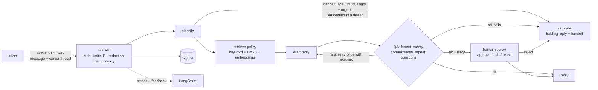

# cx-copilot

A customer-support agent that triages tickets, answers from a policy knowledge base, and hands risky
cases to a person. Built with **LangGraph**, traced with **LangSmith**, served as an HTTP API.

The point of the project is the safety net around the model:

- **It cannot promise what the business never offered.** Every timeline, refund, credit, upgrade,
  "I've escalated this" and menu path in a reply must be backed by the policy notes, or the draft is
  sent back with the reasons, and escalated if it fails twice.
- **It knows when to stop.** Danger, legal threats, fraud, angry + urgent, and a third message about
  the same problem go to a human with a fixed holding reply. Code decides that, not the model.
- **A person can check replies before they go out** (`CX_REVIEW_MODE=risky`): the run pauses, the
  reviewer approves, edits or rejects, and the pause survives a restart.
- **Every change is measured before it ships.** 125 labelled tickets (20 of them multi-turn), an
  LLM judge calibrated against human labels, a retrieval eval, cost and latency budgets, and a
  regression gate that blocks a prompt or model change that makes support worse.

**Costs nothing to run.** Models run locally with Ollama, tracing uses LangSmith's free plan, storage
is SQLite. Tests and CI use an offline stand-in model and need no keys.



## Quickstart (offline, no keys)

```bash
pip install -e ".[dev]"
pytest -q                 # 180 tests
cx-gate                   # PASS against evals/baseline.json, within budget
cx-serve                  # API on http://localhost:8000, docs at /docs
curl -s localhost:8000/v1/tickets -H 'content-type: application/json' \
     -d '{"text": "I was charged twice for order #4471"}'
```

## Made-up promises: the guardrail

The most damaging thing a support bot does is not rudeness, it is a confident promise: "I've
upgraded you to express, it will arrive tomorrow", "you'll hear back within 24 hours", "I've added a
$10 credit". Nobody made those commitments, but the customer now holds the business to them.

`rules.commitment_violations` checks every draft against the policy notes it was given:

| Check | Example it blocks | Allowed when |
|---|---|---|
| Timelines | "within 24-48 hours", "by tomorrow" | the same figure is in the policy notes, the customer said it, or it is the holding reply's "1 business day" |
| Actions | refund, replacement, credit, discount, fee waiver, shipping upgrade, "I've escalated / forwarded / will follow up" | the policy notes offer that action. Negated offers ("we can't offer a discount") are fine; "X is not offered, **but** I can give you a discount" is not |
| Menu paths | "Account > Subscriptions > Manage" | the path is in the policy notes |
| Repeat questions | asking for an order number or email the customer already gave, in this message or earlier in the thread | - |

A failing draft goes back to the model once, with the exact reasons ("invented timeline: '24 hours'
is not in the policy notes"). If the second draft also fails, the ticket is escalated: a holding
reply beats a wrong one.

Two numbers track this. `draft_commitment_free` is the share of the **model's first drafts** that
invented nothing: that is the model's behaviour. `no_invented_commitments` is the share of **sent
replies** that invented nothing: that is the guardrail, and the gate allows it no drop at all.

On the real run, 10 of the 15 drafts the rules flagged were genuine; the 5 false alarms came from
four patterns that are now fixed (see "Real results"). The rules are literal, so they miss meaning. Against 40 human-labelled replies they agree with me on
commitments 93% of the time with zero false alarms (`cx-judge --model fake`; qwen2.5:7b as a judge
managed 72%), but they pass "I'll
refund it to your card" when the policy says gift returns are "refunded as store credit": the word
"refund" is in the policy. That is the job of the LLM judge below.

`reply_v4_grounded` is the prompt written for this: only offer what the notes say, never claim to
escalate or follow up, use details the customer already gave, and treat a follow-up as a follow-up.

## Human review

```bash
CX_REVIEW_MODE=risky cx-serve      # off | risky | all
```

With `risky`, a reply is held when the customer is angry or frustrated, the ticket is urgent, it is a
follow-up in a thread, no policy matched, or the first draft failed QA. The response comes back with
`status: "pending_review"` and a `review_reason`; it must not be sent yet.

```bash
curl -s localhost:8000/v1/reviews                                  # the queue
curl -s localhost:8000/v1/tickets/<id>/review -H 'content-type: application/json' \
     -d '{"action": "edit", "reply": "...", "note": "too vague", "reviewer": "ashwin"}'
```

`approve` sends the draft, `edit` sends the reviewer's text, `reject` escalates with the holding
reply. Under the hood this is LangGraph's `interrupt()` with a SQLite checkpointer
(`CX_CHECKPOINT_PATH`): the paused run is saved, so it survives a restart, and an atomic claim makes
sure two reviewers cannot resume the same ticket. Every decision is stored with the original draft.

## Conversations

`POST /v1/tickets` takes the earlier messages too:

```json
{"text": "Order #2290. Both charges are still on my card.",
 "history": [{"role": "customer", "text": "I was charged twice for my order."},
             {"role": "agent", "text": "Sorry about that. Please reply with your order number."}]}
```

The whole thread is redacted, used for triage and retrieval, and shown to the reply model. Safety
words anywhere in the thread still escalate. The third customer message on the same thread goes to a
human (`REPEAT_CONTACT_LIMIT`): the bot has had two chances. Thread metrics: `no_repeat_questions`
and `followup_not_repeated` (the new reply is not a near-copy of the last one).

## How it is evaluated

**Dataset:** 125 labelled tickets in `src/cx_copilot/data/tickets.jsonl`: 105 single messages and
20 threads, covering every category and all 30 policies, 20 that need a human, and a set built to
tempt a model into promising things ("can you upgrade me to express for free?", "can you make an
exception just this once?", "will you price match?"). Each has a category, an escalate flag, the
facts a good reply must quote, whether it needs empathy, and the relevant policies.

**Metrics** (all free, deterministic, in `scorers.py`): category accuracy, escalation correctness and
recall, policy facts quoted, empathy, a next step, length, safety, first-try QA pass,
`draft_commitment_free`, `no_invented_commitments`, `no_repeat_questions`, `followup_not_repeated`,
retrieval recall, and a weighted `quality` composite.

**LLM judge** (`cx-judge`, optional `--judge` on `cx-gate` / `cx-compare`): a local model grades
each reply on grounded / answers the question / tone / no invented commitments. A judge is a model
that can be wrong, so it is first calibrated against 40 replies I labelled by hand
(`evals/judge_labels.jsonl`); a criterion is only trusted if Cohen's kappa is at least 0.6 and
agreement at least 85%. The report lists every disagreement.

**Retrieval** (`cx-retrieval`): recall@1, recall@2, MRR, precision and "noise" (something retrieved
for a ticket that has no relevant policy) for keyword matching, BM25, embeddings (Ollama
`nomic-embed-text`, free) and a hybrid. On the labelled set, with the gold category:

| Method | recall@1 | recall@2 | MRR | precision@2 | no-policy noise |
|---|---|---|---|---|---|
| keyword (v0.2) | 0.883 | 0.913 | 0.903 | 0.828 | 0.136 |
| BM25 | 0.767 | 0.801 | 0.786 | 0.871 | 0.091 |
| hybrid (keyword + BM25), as run | 0.922 | 0.971 | 0.952 | 0.772 | 0.182 |
| **hybrid, after the audit fix ("late" -> shipping policy), default** | **0.932** | **0.990** | **0.966** | 0.777 | 0.227 |
| embeddings (`nomic-embed-text`) | 0.806 | 0.883 | 0.845 | 0.480 | 0.591 |
| hybrid + embeddings | 0.932 | 0.981 | 0.956 | 0.524 | 0.591 |

Embeddings bought one more point of recall and tripled the noise: with them, 59% of tickets that
have no relevant policy still got one, which hands the model something irrelevant to quote. So they
stay optional (`CX_EMBED_MODEL`) and the default is keyword + BM25.

**Budgets** (`evals/budgets.json`): mean model calls, mean tokens and p95 model time per ticket,
per model. A prompt that adds a retry to every ticket can keep its quality and still double the
cost; the gate blocks it. Every response in the cache keeps its token counts and latency, so a
replayed run is still checked against the real numbers.

**Gate** (`cx-gate`): each metric has its own allowed drop (`MAX_DROP`); safety, escalation recall and
`no_invented_commitments` allow none. Exit `0` pass, `1` regression or over budget, `2` setup error.
The baseline records a fingerprint of the dataset, so scores from different ticket sets are never
compared.

## Real results: free local models

125 tickets, one repeat per setup, Ollama on a MacBook, October 2026. Total cost: $0. Full reports:
[`evals/real-v0.3/`](evals/real-v0.3/).

| | qwen2.5:7b + v1 | **qwen2.5:7b + v4** | llama3.2 (3B) + v4 |
|---|---|---|---|
| Quality (composite) | 0.900 | **0.918** | 0.887 |
| First drafts flagged by QA | 10 | 5 | 14 issues, not audited |
| ...of which real, after reading every one by hand | 6 | 4 | |
| Real: invented offer (expedite, escalation promise, ...) | 1 | **0** | |
| Real: asked again for an order number / email already given | 2 | **0** | |
| Real: invented timeline | 3 | 3 | |
| Real: invented menu path | 0 | 1 | |
| **Sent replies with an invented commitment** | **0** | **0** | **0** |
| Missed escalations (of 20) | 0 | 0 | 0 |
| Unnecessary escalations (of 105) | 6 | **3** | 13 |
| Ends with a clear next step | 0.808 | **0.941** | 0.739 |
| Empathy where needed | 0.833 | 0.896 | 0.979 |
| Tokens / ticket | 970 | 1,073 | 1,101 |
| p95 model time / ticket | 13.5 s | 14.8 s | 9.0 s |
| Gate vs qwen + v1 | reference | **PASS** (within budget) | BLOCKED |

What it showed:

- **I read every flagged draft, and 5 of the 15 flags were my rules' false alarms**: "15 days"
  (45 days since delivery minus the 30-day window: arithmetic, not invention), a menu path with a
  quote mark stuck to it, part of a real path ("Orders > Find an order"), and "I'll forward your
  suggestion" in reply to a compliment, which sent a happy customer to a human. All four patterns
  are fixed and pinned by tests. The table above shows the audited counts.
- **The guardrail held: no sent reply contained an invented commitment**, in any setup. The
  model's first drafts are another story: qwen with the original prompt promised things nobody
  offered and asked customers for order numbers they had just given. The QA node sent those drafts
  back with the reasons; the rewrite was clean, or, when it failed again (5 times for v1, 2 for
  v4), the ticket went to a human with the holding reply instead.
- **The grounded prompt (v4) removed the invented offer and both repeat questions** (small numbers:
  1 and 2 to 0), ended 94% of replies with a clear next step (from 81%), and halved unnecessary
  escalations (6 to 3) because fewer drafts failed QA twice. It costs 11% more tokens. The gate
  passed it, so it is now the default.
- **Invented timelines did not move: 3 drafts with each prompt. 5 of those 6 came from tickets where
  retrieval found no policy at all** ("my order is late"): with nothing to quote, the model made a
  number up, whatever the prompt said. The fix is upstream, not in the prompt: "late" now retrieves
  the shipping policy (hybrid recall@2 0.971 to 0.990 on the labelled set, not yet re-run on the
  real model).
- **The LLM judge was worse at catching made-up promises than the plain rules.** Calibrated against
  my 40 labels, qwen as a judge agreed 72% on "no invented commitments" (kappa 0.45, 11 false
  alarms); the deterministic check agreed 93% (kappa 0.76, no false alarms). The judge was only
  trustworthy for tone (kappa 0.72) and "answers the question" (0.63). llama3.2 as a judge was not
  trustworthy for anything. So judge scores are reported, but the gate never uses them.
- **The 3B model reads anger into calm tickets.** llama3.2 labelled "You sent me the wrong color"
  and "My order just arrived and the lamp shade is smashed" as angry and urgent, so 13 ordinary
  tickets went to a human. Its replies also left template placeholders in 6 drafts. Blocked.
- **Triage is the weakest link now: 83% category accuracy.** Most misses are on labels the triage
  prompt never defined (changing an order labelled returns, notification settings labelled
  account). Retrieval still found the right policy 98% of the time, so the replies were mostly
  fine, but this is the next thing to fix.

Reproduce everything with one command (about an hour on a laptop, all cached and resumable):

```bash
ollama pull qwen2.5:7b && ollama pull llama3.2 && ollama pull nomic-embed-text
bash scripts/full_eval.sh
```

### Earlier: v0.2, 31 tickets, 3 repeats

| Setup | Quality | Category | Missed escalations | Unnecessary escalations |
|---|---|---|---|---|
| qwen2.5:7b, `triage_v1`, model decides | 0.912 | 0.850 | **2 of 18** | 1 of 75 |
| **qwen2.5:7b, `triage_v2`, rules decide** | **0.960** | **0.957** | **0 of 18** | **0 of 75** |
| llama3.2 (3B), `triage_v1`, model decides | 0.847 | 0.753 | 0 of 18 | about 27 of 75 |
| llama3.2 (3B), `triage_v2`, rules decide | 0.925 | 0.957 | 0 of 18 | about 10 of 75 |

The model with the better overall score still missed a customer who needed a human ("Worst service
ever... I need it TODAY" labelled *frustrated*). A triage prompt with definitions and examples, plus
moving the escalation decision into code, fixed it. That is why `triage_v2` + `rules` is the default.

## Closing the loop

```bash
cx-harvest --db data/cx.db --out evals/candidates.jsonl
```

Every reply a reviewer edited or rejected, and every reply rated 0.5 or lower through
`/v1/tickets/{id}/feedback`, becomes a candidate eval case, with the reviewer's text as the
reference reply. The labels are the model's guesses, so each row is marked `needs_labels`: fix them,
append the rows to the dataset, and the next gate run tests the cases the agent actually got wrong.
Feedback is also attached to the exact LangSmith trace.

## Run it for real, free

1. Install [Ollama](https://ollama.com) and `ollama pull qwen2.5:7b` (about 16 GB RAM; `llama3.2`
   runs on 8 GB). Optional: `ollama pull nomic-embed-text` for embedding retrieval.
2. Optional: a free LangSmith account and API key, for traces and feedback.
3. ```bash
   cp .env.example .env    # set CX_ENV=prod, CX_API_KEYS, CX_MODEL=ollama:qwen2.5:7b
   docker compose up -d    # API + Ollama; review mode "risky" by default in compose
   docker compose exec ollama ollama pull qwen2.5:7b
   ```
4. `curl localhost:8000/readyz`, then send a ticket with your `X-API-Key`.

Operations, backups, the review workflow and limits: [`docs/OPERATIONS.md`](docs/OPERATIONS.md).

## The API

| Endpoint | What it does |
|---|---|
| `POST /v1/tickets` | `{"text", "ticket_id"?, "history"?}`. Idempotent on `ticket_id`; the same id with different text is a `409`. |
| `GET /v1/tickets/{id}` | A stored result. |
| `GET /v1/reviews` | Replies waiting for a person (review mode). |
| `POST /v1/tickets/{id}/review` | `{"action": "approve" \| "edit" \| "reject", "reply"?, "note"?, "reviewer"?}`. `409` if not waiting or already claimed. |
| `POST /v1/tickets/{id}/feedback` | `{"score": 0..1, "comment"}`. Stored, and attached to the LangSmith trace. |
| `GET /v1/escalations` | The human queue, with `escalation_reason`. |
| `GET /v1/stats` | Tickets, escalations, degraded runs, pending reviews, review edit rate, feedback. |
| `GET /healthz`, `/readyz` | Probes. |

Each result includes `tokens` and `model_calls`, so cost per ticket is visible in production too.

Guarantees, each covered by tests: PII (Luhn-checked cards, emails, phones, SSNs, API keys) is
redacted from the message and the whole thread before the model, trace, database or logs see it; a
model outage escalates instead of dropping the ticket; a LangSmith outage never fails a request;
feedback never upgrades a trace to paid retention; retries are idempotent; concurrency is bounded
with `503` + `Retry-After`; `CX_ENV=prod` refuses to boot without strong API keys or with the fake
model; logs are JSON and never contain ticket text.

## Compare models and prompts

```bash
cx-compare --models ollama:qwen2.5:7b ollama:qwen2.5:7b+reply_v4_grounded ollama:llama3.2+reply_v4_grounded \
           --judge ollama:qwen2.5:7b --cache .cx_cache --progress
```

An entry is `MODEL[@TRIAGE_PROMPT[/ESCALATION]][+REPLY_PROMPT]`. The first is the reference. The
report (`evals/compare.md`) has every metric with repeat-to-repeat spread, tokens and latency per
ticket, what the QA guardrail caught in each entry's first drafts, whether the gate would allow
the swap, and the exact tickets each entry got wrong. `--experiment` also logs each entry as a
LangSmith experiment (the dataset is synced under a name that includes its content hash).
`--cache` makes reruns free and identical; `--repeats 3` shows the noise.

## Layout

```
src/cx_copilot/
  graph.py          LangGraph state machine: triage, escalation rules, retrieval, drafts, QA, review
  rules.py          format, safety and commitment checks (shared by the QA node and the scorers)
  kb.py             30 policies; keyword, BM25, embedding and hybrid retrieval
  models.py         offline stand-in, Ollama / OpenAI-compatible, Anthropic, cache, token + latency capture
  scorers.py        evaluators: (outputs, reference_outputs) -> {key, score}
  judge.py          cx-judge: LLM judge + calibration (agreement, Cohen's kappa)
  runner.py         run the suite, aggregate metrics and perf; LangSmith experiments
  gate.py           cx-gate: per-metric regression limits + budgets
  compare.py        cx-compare: several models / prompts, one report
  retrieval_eval.py cx-retrieval
  harvest.py        cx-harvest: reviews and bad ratings -> candidate eval cases
  service.py, api.py, store.py, config.py, pii.py    the HTTP service
  prompts/          versioned prompts (reply v1-v4, triage v1-v2, judge v1)
  data/             tickets.jsonl (125 labelled tickets, 20 threads)
evals/              baseline.json, budgets.json, judge_labels.jsonl, reports
scripts/full_eval.sh   the whole real-model evaluation in one resumable command
docs/               OPERATIONS.md, REAL_RUN.md, SERIES.md
```

## How the stand-in model works

`FakeModel` is deterministic. It reads directives from the prompt ("quote the exact policy", "only
offer what the policy notes say", "do not ask for anything the customer already gave", ...) and
builds replies from them; without the grounding directive it over-reassures upset customers with an
invented escalation and a 24-hour promise, the way real models do. It classifies with keyword rules
and judges with the deterministic checks. That makes every part of the harness testable offline.
**It says nothing about real model quality**; the real-model section above does.

## Limits

- **My own data.** I wrote the 125 tickets, the gold labels, the 40 judge labels and the policies.
  Keyword lists and the BM25 thresholds were tuned while looking at retrieval misses on this same
  set, so the retrieval table is a development-set result, not a held-out one. `cx-harvest` exists so
  real tickets can replace mine.
- **The commitment rules are literal.** They catch phrases, not meaning (the store-credit example
  above), and the action list is English and Northwind-specific. The judge covers part of the gap.
- **Known false positive:** "smoke detector" trips the safety regex and escalates (`t105`); it is in
  the dataset on purpose and counts against the score.
- **The judge is a small local model**, and grading qwen's replies with qwen shares its blind spots.
  On real runs it was trustworthy for tone and "answers the question" only; the gate never depends
  on it.
- **One repeat per setup** in the v0.3 run (time). With 125 tickets one ticket is under a point,
  but differences of a point or two between setups are still within run-to-run noise.
- **Single instance.** In-process rate limiter, SQLite for tickets and checkpoints. Scaling out needs
  a shared limiter and Postgres (LangGraph has a Postgres checkpointer).
- **No TLS**; put a reverse proxy in front.
- **Not verified here:** the Docker image could not be built in my environment (Docker Hub was
  blocked), so CI builds and boots it on every push. The Ollama, Anthropic and OpenAI adapters are
  tested against stub clients and a local stand-in server; the real numbers come from my laptop.
- Developed against langgraph 1.2.17, langgraph-checkpoint-sqlite 3.1.2, langsmith 0.14.12,
  fastapi 0.162.

## License

MIT
